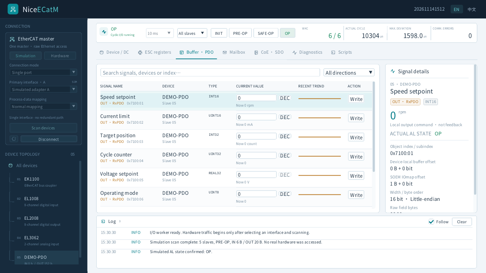
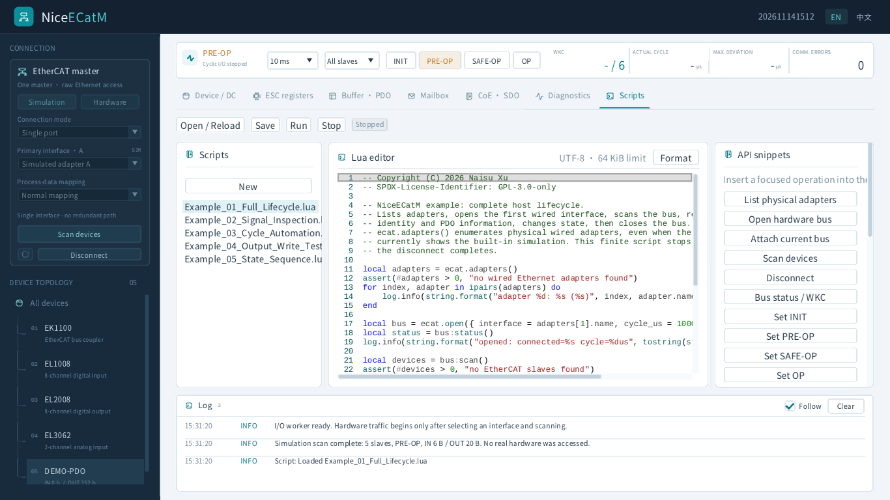
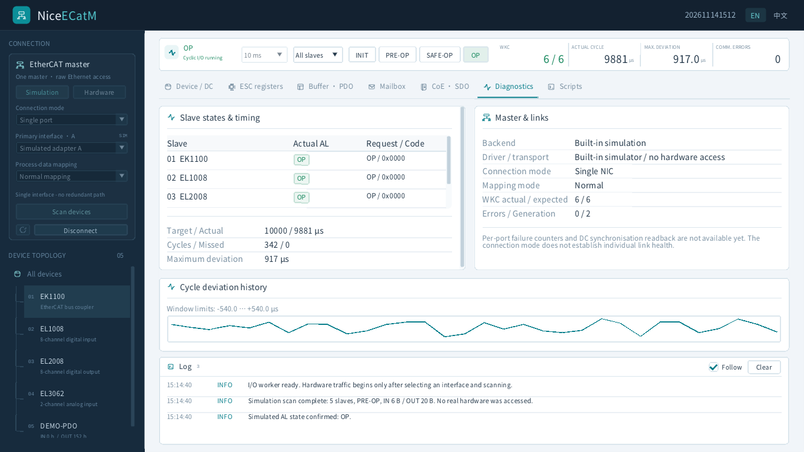

# NiceECatM

**English** | [简体中文](README.zh-CN.md)

A graphical EtherCAT development and test workbench built with C++17, CMake, SOEM V2, SDL3 and Dear ImGui. It provides device scanning, AL-state control, PDO signal testing, ESC register access, CoE SDO access and Lua automation.

Windows x64 is the locally validated build target. Ubuntu x86/ARM are supported build targets that still require platform and hardware validation. Each platform and architecture needs its own executable.

Project: [NiceECatM on GitHub](https://github.com/NaisuXu/NiceECatM)

## Screenshots

Screenshots of the Windows application using the built-in simulator.

**PDO signal values, direct output editing and recent trends**



**Lua editor, example scripts and API snippets**



**Bus diagnostics and cycle timing history**



## Build and run

For a packaged Windows release, extract the ZIP and start `NiceECatM.exe` inside its folder. Its separate English and Chinese README files describe installation, connection and use without source-build instructions. To build from a source checkout, install CMake 3.28+ and MinGW-w64, put their tools on PATH, then run:

```powershell
./scripts/build-windows.ps1
./dist/windows-x64/NiceECatM.exe
```

After building and validating, run `./scripts/package-windows.ps1` to create `dist/NiceECatM-<yyyymmddhhmm>-windows-x64.zip` and its `.zip.sha256` checksum. Packaging uses a clean install stage and includes the executable, concise English/Chinese README files, licenses, ESI and examples; it does not copy local user preferences or scripts from `dist/windows-x64/`. Release README files and third-party notices are maintained in `resources/release/`. Detailed build, architecture, validation, ESI and Lua documentation stays in the source checkout.

The bundled application libraries, including SDL and Dear ImGui, are provided at fixed versions in `third_party/`. Once platform build prerequisites are installed, configuration and compilation can run offline. Fonts and bundled application libraries are embedded; no Node, Go, Python or separate GUI runtime is needed. The Windows icon is built with MinGW's resource compiler; rcedit is not required.

Install Npcap or a compatible WinPcap installation for real Windows adapter access. The GUI and simulation work without a capture driver. Place manufacturer ESI XML files in `esi/` beside the executable for device-specific signal descriptions.

On Linux, install a C++17 compiler, CMake 3.28+, Make and the development libraries for the selected SDL display backend, then run `./scripts/build-linux.sh`. See the [build and user guide](docs/native.md) for platform requirements and commands.

## Use

1. Select the intended physical wired Ethernet adapter and scan. Scanning configures and maps responding slaves, leaving the bus in PRE-OP.
2. Select a slave in the topology. The process-data and service pages use that selection.
3. Request SAFE-OP or OP to start cyclic exchange. INIT and PRE-OP stop cyclic exchange. SAFE-OP does not apply output values at the slave.
4. Read input signals or edit mapped outputs directly. State, type, direction and range checks still apply.
5. Open Scripts for saved Lua files, API snippets and timer/cycle automation. Script messages and errors use the shared Log window.

The default target period is 10 ms; available periods are 500 us, 1, 2, 5, 10, 20, 50 and 100 ms. These are requested periods, with measured timing statistics rather than a hard real-time guarantee. Synchronous ESC register and CoE SDO access requires cyclic exchange to be stopped.

CoE / SDO displays the selected slave's object dictionary from a matching ESI and, when supported, online SDO Information in PRE-OP. Select an entry to fill its address and type; read values explicitly. Sources and partial discovery are identified, and ESI default values are never presented as current device values.

English is the default UI language. The language preference is stored in `preferences.ini` beside the executable. Scripts live in the adjacent `scripts/` directory. Build-time versions use `yyyymmddhhmm` consistently in the UI, CLI help and Windows file properties.

Click the version at the upper right to open [GitHub Releases](https://github.com/NaisuXu/NiceECatM/releases). Each desktop launch checks the latest stable release once in the background. A newer release adds a small **New version** link; all other results stay in the version tooltip, with no popups or Log messages. Updates are downloaded and installed manually.

## Project layout

```text
src/          Application, controller, backends, Lua, ESI and UI
third_party/  Vendored SOEM, SDL, ImGui, Lua, TinyXML2 and code editor
cmake/        Dependency setup, build metadata and SOEM patches
resources/    ESI files, example scripts, fonts and application icon
tests/        Deterministic software regression tests
scripts/      Build, GUI smoke and optional adapter tuning commands
docs/         Current English and Chinese documentation
build/        Generated files, isolated by build preset
dist/         Installed application packages
```

`build/windows-mingw-release/` is the Windows MinGW Release configuration. Its name keeps compiler/platform outputs separate from `build/linux-release/` and future configurations. It contains generated files and compiled dependency outputs. Dependency source remains in `third_party/` when `build/` is removed.

## Documentation

- [Release user guide](resources/release/README.md)
- [Build and user guide](docs/native.md)
- [Architecture and implemented boundaries](docs/design.md)
- [ESI descriptions and signal names](docs/esi.md)
- [Lua API and automation](docs/scripts.md)
- [Validation and release checks](docs/native-validation.md)
- [Communication performance and adapter tuning](docs/performance.md)
- [Third-party versions and licenses](THIRD_PARTY.md)

FoE, EoE, SoE and VoE services, BOOT workflows and DC trigger configuration are not implemented. Object dictionary coverage depends on the ESI and the slave's SDO Information support; online discovery is bounded and may return a partial dictionary. Same-bus redundancy and overlapped mapping require acceptance testing with the intended adapters and slaves.

## License

Copyright (C) 2026 Naisu Xu.

NiceECatM's own source code is licensed under **GPL-3.0-only** (GNU General Public License version 3 only); see [LICENSE](LICENSE) for the copyright notice and full terms. Third-party code, fonts and manufacturer ESI files retain their respective licenses and notices; see [THIRD_PARTY.md](THIRD_PARTY.md).
