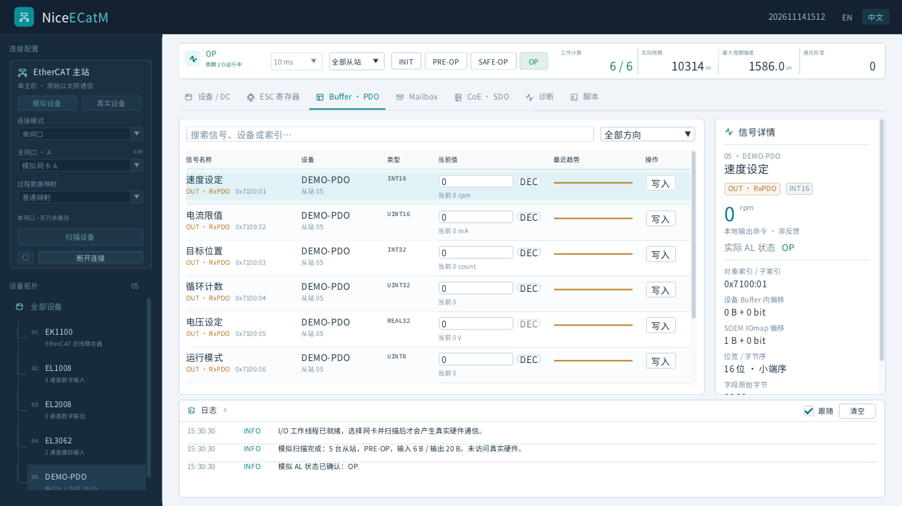
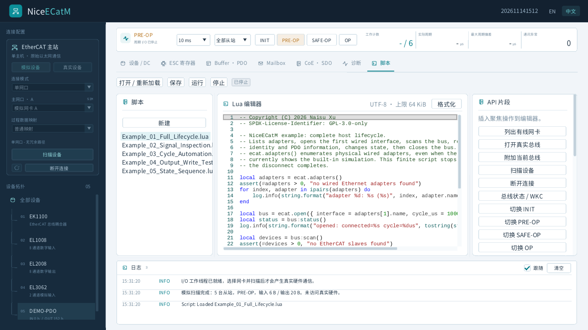
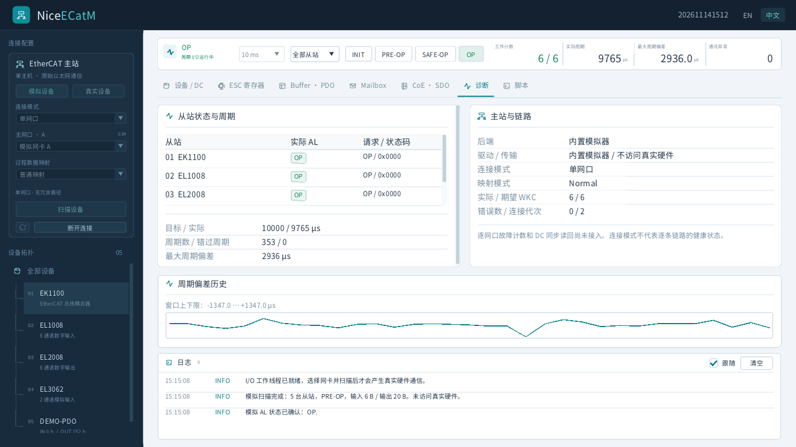

# NiceECatM

[English](README.md) | **简体中文**

面向设备开发与台架测试的 EtherCAT 图形工具，采用 C++17、CMake、SOEM V2、SDL3 和 Dear ImGui。提供设备扫描、AL 状态控制、PDO 信号测试、ESC 寄存器访问、CoE SDO 访问、EEPROM 编程和 Lua 自动化。

Windows x64 是当前本机验证的平台。Ubuntu x86/ARM 为构建目标，仍需对应平台与硬件验证；不同平台和架构分别生成各自的可执行文件。

项目主页：[NiceECatM on GitHub](https://github.com/NaisuXu/NiceECatM)

## 软件截图

以下为 Windows 版软件使用内置模拟设备的运行截图。

**PDO 信号数值、直接写入输出与最近趋势**



**Lua 编辑器、示例脚本与 API 片段**



**总线诊断与周期偏差历史**



## 构建与运行

使用 Windows 发布包时，解压 ZIP 并启动其中的 `NiceECatM.exe`，安装与操作见包内独立的中英文 README。[发布版中文使用说明](resources/release/README.zh-CN.md)单独维护，面向直接运行软件的用户。从源码构建时，安装 CMake 3.28+ 和 MinGW-w64，并将工具加入 PATH：

```powershell
./scripts/build-windows.ps1
./dist/windows-x64/NiceECatM.exe
```

完成构建与验证后，运行 `./scripts/package-windows.ps1` 生成 `dist/NiceECatM-<yyyymmddhhmm>-windows-x64.zip` 及其 `.zip.sha256` 校验文件。打包使用干净的安装暂存目录，包含程序、精简的中英文 README、许可证、ESI 和示例，不从 `dist/windows-x64/` 复制本地用户配置或脚本。详细的构建、架构、验证、ESI 和 Lua 文档保留在源码仓库中。

包括 SDL 和 Dear ImGui 在内的随附应用库均以固定版本放在 `third_party/`。安装好目标平台的构建环境后，配置和编译可离线完成。字体与随附应用库静态嵌入，不需要 Node、Go、Python 或独立图形运行时。Windows 图标由 MinGW 资源编译器生成，不需要 rcedit。

Windows 真实网卡访问需要安装 Npcap 或兼容的 WinPcap。缺少抓包驱动时仍可打开 GUI 和使用模拟设备。厂商 ESI XML 文件放在可执行文件旁的 `esi/` 中，用于补充设备信号描述。

Linux 需要 C++17 编译器、CMake 3.28+、Make，以及所选 SDL 显示后端的开发库，然后运行 `./scripts/build-linux.sh`。平台要求和详细命令见[构建与使用指南](docs/native.zh-CN.md)。

## 使用

1. 选择目标有线物理网卡并扫描。扫描会配置和映射响应的从站，结束于 PRE-OP。
2. 在左侧拓扑中选择一个从站，过程数据和服务页面共用该选择。
3. 请求 SAFE-OP 或 OP 会启动周期交换；INIT 和 PRE-OP 会停止周期交换。SAFE-OP 不会使从站应用输出值。
4. 直接读取输入或修改映射输出，仍需满足状态、类型、方向和范围限制。
5. 脚本页提供已保存的 Lua 文件、API 片段和定时/周期自动化。脚本输出与报错合并到全局“日志”。

默认目标周期为 10 ms，可选 500 us、1、2、5、10、20、50、100 ms。它们是请求周期，实际表现以统计值为准，不提供硬实时保证。同步 ESC 寄存器和 CoE SDO 访问要求停止周期交换。

CoE / SDO 显示所选从站的对象字典，来源包括匹配的 ESI，以及从站支持时在 PRE-OP 获取的在线 SDO Information。选择条目可填入地址和类型，当前值需手动读取。列表区分来源并提示获取不完整的情况，不会把 ESI 默认值显示成设备当前值。

左侧提供**模拟／硬件／编程**三种模式，默认硬件；断开连接、停止脚本且无活动操作时可以切换。编程模式使用单网口、专用 INIT 扫描，不进行 PDO 映射。**EEPROM** 页仅编程模式可用，支持从受支持的固定设备 ESI 描述或有效 SII BIN 离线准备／导出镜像、读取 EEPROM，以及烧录所选从站并完整回读比较。每次写入均确认目标、镜像与容量，Vendor ID／Product Code 不同会提示但允许烧录；写入后取消不会恢复原内容。按设备要求使配置生效，再断开、选择硬件并重新扫描后使用普通 I/O。详见 [EEPROM 使用说明](docs/native.zh-CN.md#eeprom-编程)。

`NiceECatM --esi-image file.xml`（或 `file.bin`）会在离线编程页面打开镜像，不扫描设备，也不打开抓包连接。

**导出 ESI**可从已加载的镜像或校验有效的 EEPROM 读取结果生成基础 ESI XML。导出 ESI 仅包含 EEPROM/SII 中已有的信息，无法还原完整对象字典和初始化命令。

界面默认英文，语言偏好保存在可执行文件旁的 `preferences.ini`，脚本保存在旁边的 `scripts/`。软件版本采用构建时间 `yyyymmddhhmm`，界面、CLI 帮助与 Windows 文件属性保持一致。

点击右上角版本号可打开 [GitHub Releases](https://github.com/NaisuXu/NiceECatM/releases)。桌面程序每次启动后在后台检查一次最新正式版本，发现新版时显示小型“有新版本”链接；其它结果仅在版本号悬停提示中显示，不弹窗、不写日志。下载和安装由用户手动完成。

## 项目结构

```text
src/          应用、控制器、后端、Lua、ESI 和界面
third_party/  随源码提供的 SOEM、SDL、ImGui、Lua、TinyXML2 和代码编辑器
cmake/        依赖配置、构建元数据和 SOEM 补丁
resources/    ESI、示例脚本、字体和应用图标
tests/        确定性软件回归测试
scripts/      构建、界面检查与可选网卡调参命令
docs/         当前中英文文档
build/        按构建预设隔离的生成文件
dist/         安装生成的应用发布包
```

`build/windows-mingw-release/` 表示 Windows + MinGW + Release 构建，与 `build/linux-release/` 等配置隔离。它保存生成文件和已编译的依赖产物。删除 `build/` 后，依赖源码仍保留在 `third_party/`。

## 文档

- [发布版使用说明](resources/release/README.zh-CN.md)
- [构建与使用指南](docs/native.zh-CN.md)
- [架构与当前实现边界](docs/design.zh-CN.md)
- [ESI 与信号名称](docs/esi.zh-CN.md)
- [Lua API 与自动化](docs/scripts.zh-CN.md)
- [验证与发布检查](docs/native-validation.zh-CN.md)
- [通讯性能与网卡调优](docs/performance.zh-CN.md)
- [第三方版本与许可证](THIRD_PARTY.md)

当前尚未实现 FoE、EoE、SoE、VoE 服务、BOOT 流程和 DC 触发配置。对象字典覆盖范围取决于 ESI 和从站的 SDO Information 能力；在线发现有请求和时间上限，可能返回部分字典。同一总线双口冗余和 overlapped 映射需要结合目标网卡与从站完成验收。

## 许可证

Copyright (C) 2026 Naisu Xu.

NiceECatM 自有源代码采用 **GPL-3.0-only**（GNU 通用公共许可证，仅第 3 版），版权声明及完整条款见 [LICENSE](LICENSE)。第三方代码、字体和厂商 ESI 文件保留各自的许可证及声明，详见 [THIRD_PARTY.md](THIRD_PARTY.md)。
