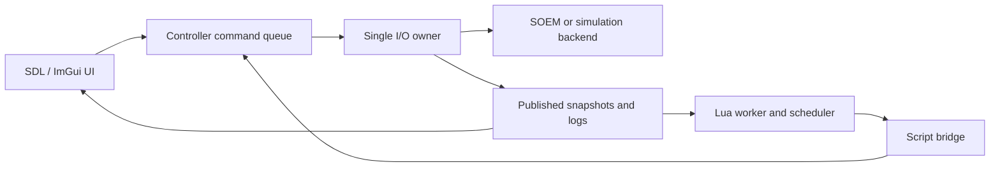

# Architecture and implemented boundaries

**English** | [简体中文](design.zh-CN.md) | [User guide](native.md)

## Ownership and data flow

One controller worker owns the backend, SOEM context, mapped image and both ports. GUI and Lua operations pass value-type commands through its bounded queue. The Lua worker may wait for a command result; it does not access SOEM pointers or run in the cyclic send/receive path. Input-only script queries may use published snapshots.

The controller publishes command results after the corresponding state snapshot. Stop/disconnect requests have reserved queue capacity. A context generation advances on scans, disconnects, backend changes and backend-error closure so obsolete queued commands can be rejected. It is a context revision, not a connection counter.

Lua bus and signal handles resolve operations against the current controller. They are not permanent generation-bound addresses; after a rescan or mapping change, discover signals and bind again.

## Source modules

| Directory | Responsibility |
| --- | --- |
| `src/app` | Process entry, CLI and SDL desktop lifecycle |
| `src/model` | Shared value types and typed PDO conversion |
| `src/master` | Command queue, backend ownership, cycles and snapshots |
| `src/ethercat` | SOEM and simulation implementations, mapping checks and bounded EEPROM transactions |
| `src/script` | Lua state, scheduler and controller bridge |
| `src/esi` | XML catalog, description matching and SII image validation/generation |
| `src/platform` | Executable-relative paths and Windows capture binding |
| `src/ui` | Workbench layout, pages and interaction |

`cmake/dependencies.cmake` owns third-party build targets. All code dependencies are vendored under `third_party/`, including `soem/`, `sdl/` and `imgui/`. SOEM's checked SDO adaptation lives in `cmake/patches/soem-sdo.cmake`. Compiled dependency outputs belong to the current build preset's `_deps` directory.

## EtherCAT addresses and states

ESC physical register offsets, logical process-image offsets and SDO Index/SubIndex are different address spaces. PDOs do not require CoE. SDO is a CoE service; mailbox transport also carries other protocols, each of which needs its own implementation.

INIT, PRE-OP, SAFE-OP and OP have confirmed request/readback paths. SAFE-OP and OP start cyclic exchange; lower states stop exchange. In SAFE-OP the master can exchange process data, but the slave does not apply output PDOs as normal active outputs. BOOT state and firmware workflows are not implemented.

Output writes prepare or update the mapped output image and preserve neighboring bits. Input and output copies remain separate. Bounds, scalar type, direction, mapping validity and device-state checks apply before modification. Register writes affecting SM/FMMU or PDO mapping invalidate the current mapping until a new scan.

Synchronous ESC and SDO services require cycles to be stopped. An OP mailbox scheduler is not implemented. The backend retains SOEM's raw failure information rather than treating an attempted request as a confirmed result.

## Mapping and timing

Single-port and same-bus dual-port redundancy share one owner and context. Overlapped mapping is a separate choice. Mapping extent checks account for SOEM's actual image layout; WKC derives from the mapped group and does not double merely because two adapters are used.

The host target period is selectable from 500 us to 100 ms. Actual cycle and maximum deviation are host measurements. A short low-WKC interval marks communication health; a continuous low-WKC failure of approximately two seconds stops the current hardware exchange. This is a failure policy, not a guaranteed response deadline under all host conditions.

Lua timers use elapsed host time. Cycle callbacks check bus cycle counters in received snapshots and may skip intermediate cycles; they cannot provide a hard real-time per-frame control loop. Callbacks run serially and must return.

## EEPROM programming

Simulation, Hardware and Programming are mutually exclusive connection modes, defaulting to Hardware. Mode changes require a disconnected bus, stopped scripts and no active job. Programming uses the same I/O owner and SOEM context as the workbench, with a single interface and no PDO mapping or cyclic exchange. A dedicated BRD/AP scan inventories responding ESCs and confirms INIT without requiring valid SII. Ordinary state, register, mailbox and Lua operations are unavailable in this mode; the EEPROM page is disabled in the other modes.

`src/esi/sii_image.*` parses supported ESI descriptions or validates a BIN into an immutable image. `src/ethercat/eeprom_job.*` implements bounded EEPROM commands, status checks, cancellation and ownership restoration. The GUI submits read/write requests through the Controller and displays published progress. Before a write, the worker validates capacity and image structure, rechecks topology and compares the target with its own scanned identity. A different identity in the new image is allowed and shown in the existing operation confirmation.

Writes skip unchanged words and compare the complete readback. Generation and metadata invalidation prevent reuse of old mappings after programming. Cancellation may leave a partial image; no rollback or automatic OP request is performed. Successful readback is reported as activation pending, because device reload, reset, power-cycle or emulation persistence requirements remain device-specific. Read/save and image export are available; automatic backups, independent backup comparison, erase, batch programming, redundant-port programming and Lua EEPROM APIs are not implemented.

## Current service limits

The application implements scanning, four-state control, mapped PDO access, ESC access, CoE SDO access, bounded SDO Information discovery, ESI dictionary/display metadata, EEPROM programming and Lua automation. Dictionary descriptions are immutable and shared across snapshots; live and offline dictionaries remain separate, with online metadata taking precedence in the UI. Device values are read explicitly and cached by connection, slave and object address. It does not implement FoE, EoE, SoE, VoE, BOOT workflows, DC SYNC trigger configuration, or per-port failover counters.

UI capability declarations are kept separate from implemented services. No menu or device flag establishes that a protocol path or redundancy recovery has been validated on hardware.

See [validation](native-validation.md), [ESI](esi.md) and [Lua](scripts.md) for their specific boundaries.
