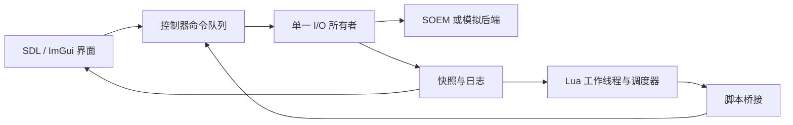

# 架构与当前实现边界

[English](design.md) | **简体中文** | [使用指南](native.zh-CN.md)

## 所有权和数据流

控制器工作线程独占后端、SOEM 上下文、映射映像和两个网口。GUI 和 Lua 通过有界队列提交值类型命令。Lua 线程可等待命令结果，不接触 SOEM 指针，不运行在周期收发关键路径；纯输入查询可使用已发布快照。

控制器先发布对应状态快照，再公开命令结果。停止/断开请求保留队列容量。扫描、断开、后端切换和后端异常关闭会递增上下文代次，拒绝旧上下文排队的命令。代次表示上下文版本，不是连接次数。

Lua 总线和信号句柄面向当前控制器解析操作，并非永久绑定某个代次的地址。重新扫描或映射变化后应重新查询和绑定信号。

## 源码模块

| 目录 | 职责 |
| --- | --- |
| `src/app` | 程序入口、CLI 和 SDL 桌面生命周期 |
| `src/model` | 共享值类型与 PDO 类型转换 |
| `src/master` | 命令队列、后端所有权、周期与快照 |
| `src/ethercat` | SOEM／模拟后端、映射检查、有界 EEPROM／FoE 任务及 Bootstrap Mailbox 会话 |
| `src/script` | Lua 状态机、调度器和控制器桥接 |
| `src/esi` | XML 目录、描述匹配和 SII 镜像校验／生成 |
| `src/platform` | 可执行文件相对路径和 Windows 抓包绑定 |
| `src/ui` | 工作台布局、页面与交互 |

第三方构建目标集中在 `cmake/dependencies.cmake`。所有代码依赖随源码放在 `third_party/`，包括 `soem/`、`sdl/` 和 `imgui/`。经过校验的 SOEM SDO 适配在 `cmake/patches/soem-sdo.cmake`，已编译的依赖产物放在对应构建预设的 `_deps` 目录中。

## 地址与状态

ESC 物理寄存器偏移、逻辑过程映像偏移和 SDO Index/SubIndex 属于不同地址空间。PDO 不要求 CoE。SDO 是 CoE 服务，Mailbox 还可承载其他协议，每种协议都需要各自的服务实现。

顶部共用按钮顺序为 **BOOT / INIT / PRE-OP / SAFE-OP / OP**，支持请求与实际读回。SAFE-OP 和 OP 启动周期交换，INIT／PRE-OP 停止交换。在 SAFE-OP 中主站仍可交换过程数据，但从站不会将输出 PDO 作为正常活动输出应用。BOOT 要求周期 I/O 与脚本已停止，在执行前检查完整目标范围，再逐站确认；进入后 PDO 映射失效，退出时经 INIT 恢复普通 Mailbox，重新扫描后才能启动周期 I/O。

输出写入准备或更新映射输出映像，并保留相邻位。输入与输出副本相互独立，修改前检查范围、标量类型、方向、映射有效性和设备状态。影响 SM/FMMU 或 PDO 映射的写入会使当前映射失效，需要重新扫描。

同步 ESC 和 SDO 服务要求停止周期交换，尚未实现 OP Mailbox 调度器。后端保留 SOEM 原始失败信息，不会把已发送请求当作已确认成功。

## 映射与周期

单口和同一总线双口冗余由同一个线程与上下文管理，overlapped 映射为独立选项。映像范围按 SOEM 实际布局核验；WKC 根据映射分组计算，不会仅因为双网口而翻倍。

主机目标周期范围为 500 us 至 100 ms。实际周期与最大偏差是主机测量结果。短暂 WKC 不足会反映通信异常，硬件交换连续约两秒 WKC 不足后停止；这是故障处理策略，不是所有主机条件下的固定响应时限。

Lua 定时器按主机时间调度，周期回调根据收到快照中的总线计数器判断触发，可能跳过中间周期，不能实现硬实时逐帧闭环。回调串行执行，每次必须返回。

## FoE 传输与 BOOT 会话

页面顺序为设备 / DC、ESC 寄存器、BufferPDO、CoE / SDO、FoE、脚本、EEPROM、诊断。FoE 共用左侧拓扑选择，不增加重复的目标选择框。硬件／模拟模式支持确认的 PRE-OP 或 BOOT 下传输，要求周期 I/O、OP 从站与脚本均已停止；选中页面或开始传输不会切换 AL 状态。编程模式选中 EEPROM，其余页面不可选，不提供 FoE 恢复路径。普通 FoE 声明和 Bootstrap Mailbox 分开显示：缺少普通 FoE 声明本身不阻止有效的 BOOT 会话，已声明也不代表某个文件名或传输方向一定可用。

`src/ethercat/foe_job.*` 在现有 SOEM 传输上处理 DATA／ACK 序列、非对称 Mailbox 容量、BUSY／重复包、有界重试／超时及协作取消。下载使用不可变临时源文件；上传流式写同目录临时文件，在最终协议交互成功后才提交目标。文件内容不进入 FoE 命令／结果数据、结果历史或快照。任务绑定请求、代次与从站，活动传输拒绝冲突操作和脚本启动；断开／退出先取消，再由 I/O 所有者关闭传输。密码不保存、不记录。文件上限为 128 MiB，上传默认接收上限为 16 MiB。

任务使用短时间 Mailbox 等待，不直接使用阻塞整个传输的 `ecx_FOEread/write`。BUSY 不能无限延长总超时或无进展超时，协议重试也不会重启整个下载。下载进度按已确认字节计算；上传通常没有已知总长度，不把接收上限当作总大小。设备文件名独立于本地路径，按发送 Mailbox 的编码字节容量检查，禁止静默截断。错误保留远端码／文字，并区分本地文件、通信、超时和目标变化；进度快照保持小型，日志不逐包输出。

`src/ethercat/bootstrap_session.hpp` 在部分操作失败时保留普通 Mailbox 配置。进入 BOOT 使用逐站实时 AL 读回，确认 INIT 后按有效 SII Bootstrap 参数配置并核验 SM0／SM1，再逐站确认 BOOT。退出先确认 INIT，再完整写入／读回普通 SM，成功后才清除保存配置，不通过广播或聚合状态确认 BOOT。PDO／SDO 明确拒绝 BOOT 状态。

BOOT 沿用顶部当前／全部从站范围。全部从站进入前先检查每个目标，初始检查通过才改变状态；执行中失败则停止后续切换，不回滚已完成的状态变化。无法完成普通硬件扫描的设备不在恢复范围内。FoE 复用原有 SOEM 上下文和冗余传输，overlapped PDO 映射不改变 FoE 包格式。

**FoE 完成仅表示文件传输成功，固件是否生效由从站决定。**取消不撤销已接收的从站数据，不会自动恢复 OP。未实现目录浏览、断点续传和批量传输。协议／会话通过模拟及故障注入测试；单台真实 ECAT_Device 已检查 PRE-OP／BOOT 上传、PRE-OP 下载回读以及文件名／密码拒绝。这不代表其他从站固件均受支持，也未验证固件激活；实测范围见[验证文档](native-validation.zh-CN.md)。

## EEPROM 编程

模拟、硬件、编程是互斥的连接模式，默认硬件。切换要求总线断开、脚本停止且没有活动任务。编程复用工作台的 I/O 所有者和 SOEM 上下文，限定单网口，不进行 PDO 映射或周期交换。专用 BRD/AP 扫描枚举响应 ESC 并确认 INIT，不依赖有效 SII。此模式只有 EEPROM 页面可选，不能执行普通状态、寄存器、Mailbox 或 Lua 操作；其它模式下 EEPROM 页面禁用。

`src/esi/sii_image.*` 将支持的 ESI 描述或经过校验的 BIN 转成不可变镜像。`src/ethercat/eeprom_job.*` 负责有界 EEPROM 命令、状态检查、取消与控制权恢复。GUI 通过 Controller 提交读写请求并显示已发布的进度。写入前由工作线程检查容量和镜像结构，重新核对拓扑，并将目标与它自身的扫描身份比较。新镜像可以使用不同标识，在现有本次操作确认中展示差异。

写入跳过未改变的 word，并比较完整回读。编程会使旧代次和元数据失效，避免继续使用旧映射。取消可能留下部分镜像，不自动回滚或请求 OP。回读成功后显示等待生效，因为具体设备可能需要重载、复位、重新上电或保存仿真内容。支持读取保存和导出镜像；未实现自动备份、独立备份比较、擦除、批量烧录、冗余口烧录和 Lua EEPROM API。

## 当前服务边界

已实现扫描、BOOT／INIT／PRE-OP／SAFE-OP／OP 状态控制、映射 PDO、ESC、CoE SDO 访问、有预算上限的 SDO Information 字典发现、ESI 字典及显示元数据、图形 FoE 文件传输、EEPROM 编程和 Lua 自动化。字典描述不可变并在快照间共享；在线与离线字典分开保存，界面优先采用在线元数据。设备当前值手动读取，缓存按连接、从站和对象地址隔离。未实现 EoE、SoE、VoE、厂商专用固件激活、与周期 I/O 并行的 FoE、Lua／CLI 文件传输 API、DC SYNC 触发配置和逐网口故障切换计数。

界面将设备声明能力与实际服务实现分开。菜单或设备标志不代表某条协议路径或冗余恢复已在硬件上验收。

具体边界见[验证](native-validation.zh-CN.md)、[ESI](esi.zh-CN.md)和 [Lua](scripts.zh-CN.md)文档。
