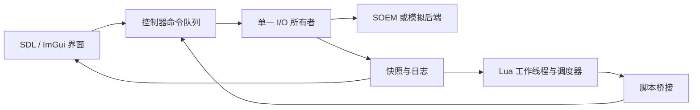

# 架构与当前实现边界

[English](design.md) | **简体中文** | [使用指南](native.zh-CN.md)

## 所有权和数据流

控制器工作线程独占后端、SOEM 上下文、映射映像和两个网口。GUI 和 Lua 通过有界队列提交值类型命令。Lua 线程可等待命令结果，不接触 SOEM 指针，不运行在周期收发关键路径；纯输入查询可使用已发布快照。

控制器先发布对应状态快照，再公开命令结果。停止/断开请求保留队列容量。扫描、断开、后端切换和后端异常关闭会递增上下文代次，拒绝旧上下文排队的命令。代次表示上下文版本，不是连接次数。

Lua 总线和信号句柄面向当前控制器解析操作，并非永久绑定某个代次的地址。重新扫描或映射变化后应重新查询和绑定信号。

## 源码模块

| 目录 | 职责 |
| --- | --- |
| `src/app` | 程序入口、CLI 和 SDL 桌面生命周期 |
| `src/model` | 共享值类型与 PDO 类型转换 |
| `src/master` | 命令队列、后端所有权、周期与快照 |
| `src/ethercat` | SOEM、模拟后端与映射检查 |
| `src/script` | Lua 状态机、调度器和控制器桥接 |
| `src/esi` | XML 目录与描述匹配 |
| `src/platform` | 可执行文件相对路径和 Windows 抓包绑定 |
| `src/ui` | 工作台布局、页面与交互 |

第三方构建目标集中在 `cmake/dependencies.cmake`。所有代码依赖随源码放在 `third_party/`，包括 `soem/`、`sdl/` 和 `imgui/`。经过校验的 SOEM SDO 适配在 `cmake/patches/soem-sdo.cmake`，已编译的依赖产物放在对应构建预设的 `_deps` 目录中。

## 地址与状态

ESC 物理寄存器偏移、逻辑过程映像偏移和 SDO Index/SubIndex 属于不同地址空间。PDO 不要求 CoE。SDO 是 CoE 服务，Mailbox 还可承载其他协议，每种协议都需要各自的服务实现。

INIT、PRE-OP、SAFE-OP、OP 支持请求与实际读回。SAFE-OP 和 OP 启动周期交换，较低状态停止交换。在 SAFE-OP 中主站仍可交换过程数据，但从站不会将输出 PDO 作为正常活动输出应用。当前未实现 BOOT 和固件流程。

输出写入准备或更新映射输出映像，并保留相邻位。输入与输出副本相互独立，修改前检查范围、标量类型、方向、映射有效性和设备状态。影响 SM/FMMU 或 PDO 映射的写入会使当前映射失效，需要重新扫描。

同步 ESC 和 SDO 服务要求停止周期交换，尚未实现 OP Mailbox 调度器。后端保留 SOEM 原始失败信息，不会把已发送请求当作已确认成功。

## 映射与周期

单口和同一总线双口冗余由同一个线程与上下文管理，overlapped 映射为独立选项。映像范围按 SOEM 实际布局核验；WKC 根据映射分组计算，不会仅因为双网口而翻倍。

主机目标周期范围为 500 us 至 100 ms。实际周期与最大偏差是主机测量结果。短暂 WKC 不足会反映通信异常，硬件交换连续约两秒 WKC 不足后停止；这是故障处理策略，不是所有主机条件下的固定响应时限。

Lua 定时器按主机时间调度，周期回调根据收到快照中的总线计数器判断触发，可能跳过中间周期，不能实现硬实时逐帧闭环。回调串行执行，每次必须返回。

## 当前服务边界

已实现扫描、四状态控制、映射 PDO、ESC、手动 CoE SDO、ESI 显示元数据和 Lua 自动化。未实现 FoE、EoE、SoE、VoE、BOOT、完整 SDO Info 字典浏览、EEPROM 备份比较、DC SYNC 触发配置和逐网口故障切换计数。

界面将设备声明能力与实际服务实现分开。菜单或设备标志不代表某条协议路径或冗余恢复已在硬件上验收。

具体边界见[验证](native-validation.zh-CN.md)、[ESI](esi.zh-CN.md)和 [Lua](scripts.zh-CN.md)文档。
